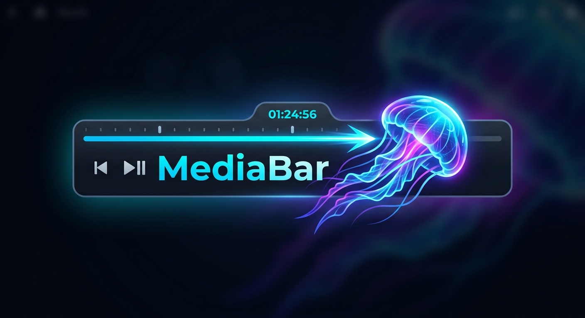

<h1 align="center">Media Bar ALEXFLIX</h1>

<p align="center">
  
</p>

<p align="center">
  <strong>A more cinematic, responsive featured-content experience for Jellyfin.</strong><br>
  Built on the original Media Bar, refined for Jellyfin 12.
</p>

<p align="center">
  <a href="https://github.com/Wishmaster117/jellyfin-plugin-media-bar/releases/tag/v1.0.0.0"></a>
  
  
  <a href="LICENSE.md"></a>
</p>

**Media Bar ALEXFLIX** is an independently maintained adaptation of [Jellyfin Plugin Media Bar](https://github.com/IAmParadox27/jellyfin-plugin-media-bar), itself based on [MakD's Jellyfin Media Bar](https://github.com/MakD/Jellyfin-Media-Bar). It enhances Jellyfin's home screen with a featured-content showcase while preserving the original projects' credits and history.

> **Current stable release:** **1.0.0.0 (RC6 / V66)** — validated with **Jellyfin 12.2.0**.

## Why choose ALEXFLIX?

The original Media Bar provides the foundation. **These are the ALEXFLIX-specific additions and refinements**, rather than features being claimed as entirely new inventions.

| ALEXFLIX enhancement | What it improves |
| --- | --- |
| **On/off control for each device** | Hide Media Bar in one browser or device without disabling it for everyone. Re-enable it from a recovery button on the home screen. |
| **Jellyfin 12 home-screen integration** | Better placement and lifecycle handling when Jellyfin rebuilds the home page or users navigate away and back. |
| **More immersive web trailers** | In the Marquee layout, active trailers can fill the featured area instead of leaving an exposed side section, while retaining text contrast. |
| **Jellyfin Media Player refinements** | Compatibility fixes for older QtWebEngine/DOM behavior, trailer sizing and positioning, and the Marquee progress indicator. |
| **Mobile portrait polish** | A more compact Marquee layout, adjusted controls and spacing, and slide rebuilding when the device switches orientation without refetching the whole selection. |
| **Client preferences respected** | Explicitly choosing whether trailers are enabled on a client is no longer silently overridden by the server's general trailer setting. |
| **More resilient UI behavior** | Additional fixes for translation loading, layout measurements, responsive repositioning, and slide/trailer transitions. |

### Turn it off on just one device

The settings panel includes **“Enable MediaBar on this device”**. Disabling it saves a **local preference** on that browser/WebView; it does **not** change the plugin's global Jellyfin setting.

A recovery control appears on the home screen so Media Bar can be switched back on without clearing browser data. An optional **`?alexflix=restore`** URL recovery path is also available, with confirmation.

The device-control and recovery labels are available in **English, French, German, Spanish, Portuguese and Italian**.

### Trailer and layout improvements

ALEXFLIX refines the presentation of active video trailers on web clients and adds dedicated compatibility handling for **Jellyfin Media Player**. On small portrait screens, the Marquee card and controls have been adjusted for a less crowded interface. Desktop, TV and landscape layouts use separate rules where appropriate.

The underlying featured-content experience—including **Plate and Marquee layouts, media details, navigation and trailer support**—builds on the original projects. These inherited capabilities are not presented here as exclusively ALEXFLIX features.

## Installation

**Use the ALEXFLIX catalog, not the original Media Bar catalog, for ALEXFLIX releases and updates.**

1. Install the [File Transformation plugin](https://github.com/IAmParadox27/jellyfin-plugin-file-transformation) if it is not already installed; Media Bar uses its file-transformation integration to inject the interface.
2. In Jellyfin, open **Dashboard → Plugins → Repositories**.
3. Add this repository URL:

   ```text
   https://raw.githubusercontent.com/Wishmaster117/jellyfin-plugin-media-bar/main/manifest.json
   ```

4. Open **Catalog**, find **Media Bar ALEXFLIX**, and install **version 1.0.0.0**.
5. Restart Jellyfin and hard-refresh the web client if the bar does not appear immediately.

**Official download:** [Media Bar ALEXFLIX v1.0.0.0](https://github.com/Wishmaster117/jellyfin-plugin-media-bar/releases/tag/v1.0.0.0)

The released package contains the plugin DLL, its dependency manifest and the logo. The slideshow JavaScript and CSS are embedded in the plugin assembly, keeping the delivered frontend tied to this version.

### Compatibility and independence

| Item | Stable release |
| --- | --- |
| Tested Jellyfin server | **12.2.0** |
| Plugin version | **1.0.0.0** |
| Runtime | **.NET 10** |
| ALEXFLIX plugin ID | `d61bd3d1-8bd3-4e5a-b81b-95184275dd4b` |
| Distribution | [Independent ALEXFLIX catalog](manifest.json) and [GitHub releases](https://github.com/Wishmaster117/jellyfin-plugin-media-bar/releases) |

Other Jellyfin server versions have **not** been validated for this release. ALEXFLIX has its own plugin ID, separate from the original Media Bar (`08f615ea-2107-4f04-89cc-091035f54448`). The original plugin's packages and catalog are **not** ALEXFLIX update sources. Avoid enabling both frontends at once, since both can inject a Media Bar into Jellyfin's interface.

## Known limitations

- **Android Jellyfin app:** Android WebView can pause embedded YouTube trailer playback when sound is enabled. V66 includes protective playback handling, but this platform limitation is **not considered fully resolved**.
- **Android TV / Fire TV:** Native TV clients may use an interface different from Jellyfin Web and may not render this Media Bar.
- **Client differences:** Trailer autoplay and audio behavior depend on the client engine and its media policies. A feature working in a desktop browser is not a guarantee of identical behavior in every app.

Experimental Android builds and later audio investigations are **not part of the stable V66 release**.

## Project and updates

- **Stable source:** [`main`](https://github.com/Wishmaster117/jellyfin-plugin-media-bar/tree/main)
- **Validated V66 source:** [`release/alexflix-v66`](https://github.com/Wishmaster117/jellyfin-plugin-media-bar/tree/release/alexflix-v66)
- **Original upstream baseline preserved:** [`archive/original-upstream`](https://github.com/Wishmaster117/jellyfin-plugin-media-bar/tree/archive/original-upstream)
- **Releases:** [GitHub releases](https://github.com/Wishmaster117/jellyfin-plugin-media-bar/releases)
- **Issues:** [Report an ALEXFLIX-specific issue](https://github.com/Wishmaster117/jellyfin-plugin-media-bar/issues)

Future validated versions can be published through the ALEXFLIX release and catalog workflow. The currently installed stable release does not need to be replaced simply because this README changes.

## Credits and attribution

ALEXFLIX is a **derivative project**, not an original implementation from scratch. The underlying Media Bar and its existing features are the work of the original authors and contributors.

- **MakD** — [Jellyfin Media Bar](https://github.com/MakD/Jellyfin-Media-Bar), original project.
- **IAmParadox27** — [Jellyfin Plugin Media Bar](https://github.com/IAmParadox27/jellyfin-plugin-media-bar), plugin adaptation and development.
- **BobHasNoSoul**, **SethBacon**, **TedHinklater** — contributions and influences acknowledged by the original projects.
- **Wishmaster117** — ALEXFLIX-specific modifications, integration, release and maintenance.

Thanks to all contributors represented in the preserved Git history.

## License

This project retains the inherited **[DBAD 1.2 license](LICENSE.md)** and the original copyright notice. The upstream Git history and baseline have also been preserved.
